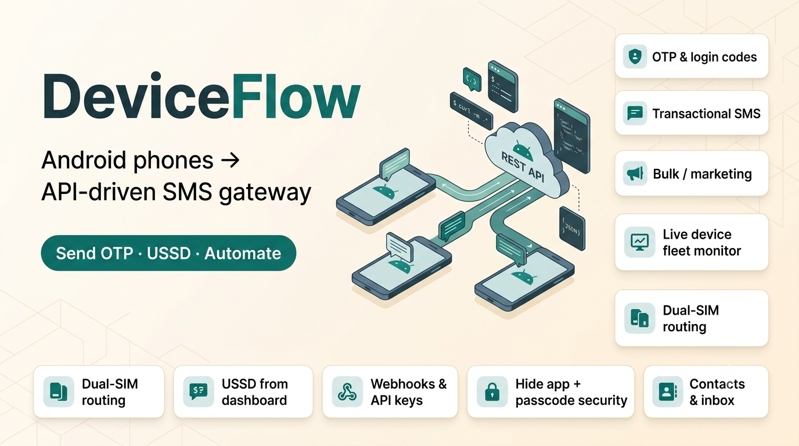
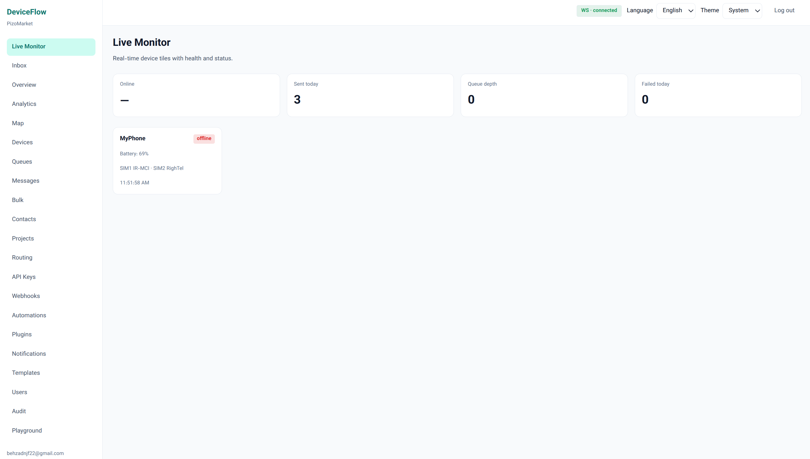

# DeviceFlow

[](./LICENSE)

<p align="center">
  
</p>

<p align="center">
  
</p>

**Turn Android phones into an API-driven SMS gateway and device automation fleet.**

DeviceFlow pairs real phones with a multi-tenant control plane. Operators manage devices from a web dashboard; apps and backends send SMS, run USSD, import contacts, and issue remote commands through a REST API and live WebSocket updates.

<p align="center">
  
</p>

<p align="center"><em>Dashboard Live Monitor — real-time device health, queues, and fleet status</em></p>

---

## What’s included

| Component | Path | Role |
|-----------|------|------|
| **Backend** | [`backend/`](./backend) | Django REST API, WebSockets (Channels), Celery tasks, multi-tenant auth |
| **Dashboard** | [`dashboard/`](./dashboard) | React + Vite ops UI (EN / FA), live device monitor |
| **Android agent** | [`android-agent/`](./android-agent) | Kotlin app: pair, heartbeat, send/receive SMS, remote commands |
| **Deploy** | [`deploy/`](./deploy) | Docker Compose, optional Kubernetes / Grafana assets |
| **Docs** | [`docs/`](./docs) | Architecture, API, security, ops |

---

## Features

- **Device pairing** — generate a code in the dashboard; the phone (or mock agent) pairs and stays online via heartbeat
- **SMS send / receive** — project routing, API keys, templates, bulk campaigns, inbox & contacts
- **Optional customer routes** — map `route_key` (e.g. PizoGold customer UUID) → phone/SIM on a shared project; omit `route_key` to keep classic pool routing
- **Live ops** — device health, queues, timeline, map (GPS from agent), remote commands
- **USSD** — run carrier codes from the dashboard (agent + Accessibility on some OEMs)
- **App security** — hide launcher icon, UI passcode lock, customizable secret dialer code (`*#*#CODE#*#*`)
- **Developer DX** — OpenAPI / Swagger, webhooks, automations, plugins, Prometheus metrics

---

## Architecture (how things sync)

```text
┌─────────────┐     JWT / WS      ┌──────────────────┐
│  Dashboard  │◄─────────────────►│  Django API      │
└─────────────┘                   │  (+ Redis/Celery)│
                                  └────────┬─────────┘
                                           │
                    Device token · HTTP poll (~3s) · heartbeat (~15s)
                                           │
                                  ┌────────▼─────────┐
                                  │  Android agent   │
                                  │  (foreground svc)│
                                  └──────────────────┘
```

1. **Pair** — Dashboard creates a short-lived pairing code → agent `POST /agent/pair/` → receives `device_token`.
2. **Heartbeat** — Agent posts battery, SIM, GPS, capabilities, and security flags; backend marks the device online.
3. **Work** — Agent polls `GET /agent/commands/pending/` for SMS + control commands; acks results.
4. **Live UI** — Dashboard WebSocket receives `device.updated`, `command.acked`, SMS events, etc.

The agent does **not** require a persistent WebSocket; polling is the source of truth for device work.

---

## Prerequisites

- **Python** 3.11+ (3.12 recommended)
- **Node.js** 20+ and npm
- **Redis** (recommended for WebSockets / Celery in Docker; local settings can run Celery eagerly without a worker)
- **Android Studio** (for the real agent) + a physical phone with SMS permissions
- Optional: **Docker** + Docker Compose for Postgres/Redis/API

---

## Quick start (local development)

### 1. Environment

From the repo root:

```bash
cp .env.example .env
```

Defaults use **SQLite** (`backend/db.sqlite3`) when `DATABASE_URL` is unset. Point `VITE_API_BASE_URL` at your API (see `.env.example`).

### 2. Backend

```bash
cd backend
python3 -m venv .venv
source .venv/bin/activate          # Windows: .venv\Scripts\activate
pip install -r requirements/base.txt

python manage.py migrate
python manage.py seed_operator_prefixes   # IR operator prefix map (optional but useful)
python manage.py collectstatic --noinput
python manage.py createsuperuser          # first login for Django admin / bootstrap

# HTTP + WebSockets
uvicorn config.asgi:application --host 0.0.0.0 --port 8000 --reload
```

- Health: [http://localhost:8000/api/v1/health/](http://localhost:8000/api/v1/health/)
- OpenAPI schema: `/api/v1/schema/`
- Swagger UI: `/api/v1/docs/`
- Django admin: `/admin/`

`config.settings.local` runs Celery tasks **eagerly** (in-process), so you can develop without starting a worker. For production-like offline detection and async jobs, run Redis + Celery beat/worker (see Docker below).

### 3. Dashboard

```bash
cd dashboard
npm install
npm run dev
```

Open [http://localhost:5173](http://localhost:5173).

Typical first flow:

1. Sign in (use an account created via admin / invite).
2. **Devices** → create a pairing code.
3. Pair the Android agent or mock agent with that code.
4. Attach the device to a **Project**, then send a test SMS from **Messages**.

Set API URL via `dashboard/.env` or root `.env`:

```bash
VITE_API_BASE_URL=http://localhost:8000/api/v1
```

### 4. Mock agent (no phone)

Useful to verify pairing and outbound SMS without Android:

```bash
# API must be running; use a pairing code from the dashboard
python scripts/mock_agent.py --code YOURCODE --base-url http://127.0.0.1:8000/api/v1
```

### 5. Android agent

1. Open [`android-agent/`](./android-agent) in Android Studio and sync Gradle.
2. Or build from CLI:

```bash
cd android-agent
./gradlew assembleDebug
# APK: app/build/outputs/apk/debug/app-debug.apk
```

3. Install on a **real device** (emulator SMS is limited).
4. Grant SMS / Phone / Notifications (and related) permissions.
5. Enter your server URL (phone must reach the host — use LAN IP, not `localhost`) and the pairing code.
6. Start the agent service; confirm **Online / Synced** on the home screen.

More detail: [android-agent/README.md](./android-agent/README.md).

**Networking tip:** On a physical phone, `http://10.0.2.2:8000` is the emulator alias only. Use your PC’s LAN IP (e.g. `http://192.168.x.x:8000/api/v1`) and ensure `ALLOWED_HOSTS` / firewall allow it.

### 6. Docker Compose

```bash
cp .env.example .env
docker compose -f deploy/docker-compose.yml up --build
```

This starts Postgres, Redis, and the API on port **8000**. Run the dashboard locally against that API, or extend Compose for your own frontend image.

---

## Configuration reference

| Variable | Purpose |
|----------|---------|
| `SECRET_KEY` | Django secret (change in production) |
| `DEBUG` | Debug mode |
| `ALLOWED_HOSTS` | Comma-separated hosts |
| `DATABASE_URL` | Postgres URL; omit for SQLite |
| `REDIS_URL` | Redis for Celery / Channels |
| `CHANNELS_USE_REDIS` | `true` to use Redis channel layer (Docker sets this) |
| `CORS_ALLOWED_ORIGINS` | Dashboard origins |
| `JWT_ACCESS_MINUTES` / `JWT_REFRESH_DAYS` | Auth token lifetimes |
| `DEVICE_OFFLINE_AFTER_SECONDS` | Mark devices offline without heartbeat |
| `VITE_API_BASE_URL` | Dashboard → API base path |

Never commit real `.env` files; `.env.example` is the template.

---

## API overview

Base path: `/api/v1/`

| Area | Examples |
|------|----------|
| Auth | JWT login / refresh |
| Devices | Pairing codes, list/detail, remote commands, OTA |
| Agent | `pair`, `heartbeat`, `commands/pending`, message status, inbound SMS |
| Messaging | Send, bulk, templates, conversations |
| Projects | API keys, webhooks, project–device links |
| Routing | Rules, operators, load-balancing config |
| Ops | Analytics, queues, map, audit logs, metrics (`/metrics`) |

Authenticate dashboard users with **JWT**. Integrate server-side with **project API keys** (`Authorization: ApiKey …`) and optional `Idempotency-Key` on send.

Interactive docs: `/api/v1/docs/`.

---

## Example: send an OTP from your backend

Typical setup:

1. Pair an Android phone and attach it to a **Project** in the dashboard.
2. Create a **project API key** (Projects → API keys). Copy the secret once.
3. From your app backend, call DeviceFlow with `mode: "otp"` so the message is prioritized over marketing traffic.

### cURL

```bash
export DEVICEFLOW_URL="https://your-api.example.com/api/v1"
export DEVICEFLOW_API_KEY="df_live_xxxxxxxx"   # project API key
export USER_PHONE="+989121234567"
export OTP_CODE="482915"

curl -sS -X POST "$DEVICEFLOW_URL/messages/send/" \
  -H "Authorization: ApiKey $DEVICEFLOW_API_KEY" \
  -H "Content-Type: application/json" \
  -H "Idempotency-Key: otp-$USER_PHONE-$(date +%s)" \
  -d "{
    \"to\": \"$USER_PHONE\",
    \"text\": \"Your verification code is $OTP_CODE. It expires in 5 minutes.\",
    \"mode\": \"otp\",
    \"client_ref\": \"signup-$USER_PHONE\"
  }"
```

Successful enqueue returns **202** with a message id, for example:

```json
{
  "id": "a1b2c3d4-....",
  "status": "queued",
  "mode": "otp",
  "to_number": "+989121234567",
  "created_at": "2026-07-24T15:00:00Z"
}
```

The online agent picks the job up within a few seconds, sends the SMS, then reports `sent` / `failed` back to the API (visible in the dashboard Messages / Live views).

### Python

```python
import os
import secrets
import httpx

API = os.environ["DEVICEFLOW_URL"].rstrip("/")  # e.g. https://api.example.com/api/v1
KEY = os.environ["DEVICEFLOW_API_KEY"]

def send_otp(phone: str) -> tuple[str, str]:
    code = f"{secrets.randbelow(1_000_000):06d}"
    r = httpx.post(
        f"{API}/messages/send/",
        headers={
            "Authorization": f"ApiKey {KEY}",
            "Idempotency-Key": f"otp-{phone}-{code}",
        },
        json={
            "to": phone,
            "text": f"Your verification code is {code}. It expires in 5 minutes.",
            "mode": "otp",
            "client_ref": f"login-{phone}",
        },
        timeout=15.0,
    )
    r.raise_for_status()
    return code, r.json()["id"]

# Store `code` (hashed) in your session/DB, then verify what the user types.
otp, message_id = send_otp("+989121234567")
```

### Tips for OTP

- Always set `"mode": "otp"` — OTP traffic is queued ahead of marketing / general messages.
- Use a unique **`Idempotency-Key`** per send so retries from your backend do not duplicate SMS.
- Prefer **E.164** numbers (`+98…`, `+1…`).
- Keep the text short; generate the code in **your** app and only send it through DeviceFlow.
- Optionally force a device with `"device": "<device-id-or-name>"`, or let project routing pick a healthy phone.
- Watch delivery in the dashboard or poll `GET /messages/{id}/`.

---

## Remote commands & app security

From the device detail page (or `POST /devices/{id}/commands/`), you can:

| Command | Effect |
|---------|--------|
| `sync`, `refresh_sim`, `clear_queue`, `restart_agent`, `enable_logs` | Ops / diagnostics |
| `ussd_run` | Dial USSD on the phone |
| `contacts_read` | Import contacts into the platform |
| `hide_launcher` / `show_launcher` | Remove / restore app icon |
| `lock_ui` / `unlock_ui` / `set_passcode` / `clear_passcode` | Soft UI lock |
| `set_dialer_code` | Customize reopen code (dial `*#*#CODE#*#*`) |

Security state (`launcher_hidden`, `ui_locked`, `passcode_set`, `dialer_code`) is reported on heartbeat and shown in the dashboard.

---

## Repository layout

```text
SMSGateway/
├── backend/           # Django project (apps, config, plugins)
├── dashboard/         # React SPA
├── android-agent/     # Kotlin Compose agent
├── Images/            # Brand assets (icon, banner, dashboard screenshot)
├── deploy/            # docker-compose, k8s, grafana
├── docs/              # Product & engineering docs
├── scripts/           # mock_agent, load_test, helpers
└── .env.example
```

---

## Production notes

- Set a strong `SECRET_KEY`, `DEBUG=false`, and tight `ALLOWED_HOSTS` / CORS.
- Use PostgreSQL + Redis; run **uvicorn** (ASGI), **Celery worker**, and **Celery beat**.
- Terminate TLS in front of the API; prefer HTTPS URLs in the Android agent.
- Collect static files behind WhiteNoise or your CDN.
- Review [docs/security/03-SECURITY-CHECKLIST.md](./docs/security/03-SECURITY-CHECKLIST.md) and [docs/ops/08-BACKUP-RESTORE.md](./docs/ops/08-BACKUP-RESTORE.md).
- Kubernetes starter: [`deploy/k8s/`](./deploy/k8s/).

---

## Documentation

| Topic | Link |
|-------|------|
| Docs index | [docs/00-INDEX.md](./docs/00-INDEX.md) |
| Vision | [docs/01-VISION-AND-PRODUCT-STRATEGY.md](./docs/01-VISION-AND-PRODUCT-STRATEGY.md) |
| REST API | [docs/api/01-REST-API.md](./docs/api/01-REST-API.md) |
| Device protocol | [docs/api/03-DEVICE-COMMUNICATION-PROTOCOL.md](./docs/api/03-DEVICE-COMMUNICATION-PROTOCOL.md) |
| Plugin SDK | [docs/plugins/01-PLUGIN-SDK.md](./docs/plugins/01-PLUGIN-SDK.md) |
| Android agent | [android-agent/README.md](./android-agent/README.md) |

---

## License

Licensed under the **Apache License, Version 2.0**. See [LICENSE](./LICENSE).

Attribution is required via [NOTICE](./NOTICE): if you use or redistribute DeviceFlow (including forks and deployments), you must credit the original project and link the source repository:

**https://github.com/behzad-njf/DeviceFlow**

Suggested credit line:

```text
Based on DeviceFlow — https://github.com/behzad-njf/DeviceFlow
```
